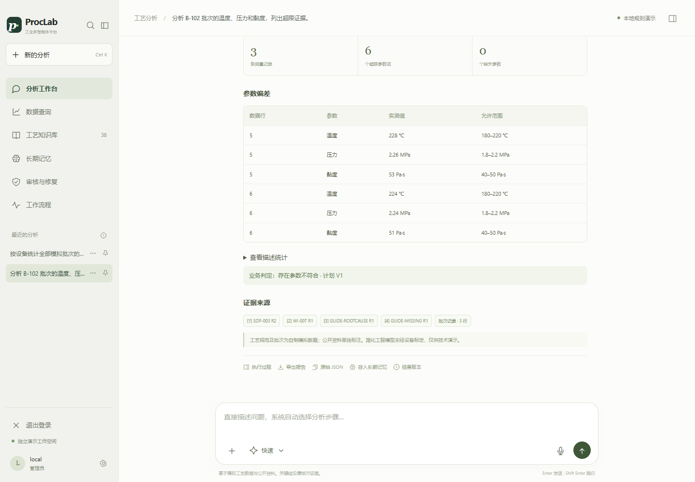

# ProcLab

### 让结论经得起证据与计算的复核

**可追溯工业多智能体研究工作台：受控分析、科学工具、独立校验与版本化结果。**

[English](README.md) · [架构](docs/architecture.md) · [研究指南](docs/research.md) · [参与贡献](CONTRIBUTING.md)

很多 Agent 演示展示的是“任务执行成功”。ProcLab 还关心：输入依据是否明确、工具是否越权、计算是否可独立复算、缺失证据是否被补全，以及发布结果能否追溯到原始测量。

这是可运行的开源研究原型。数据与限值均为自制模拟；可以无模型密钥、无 Docker 运行，再接入真实模型和检索服务开展对比实验。

## 已实现的能力

| 方向 | 可以检查的内容 |
|---|---|
| 多智能体编排 | 需求解析、冻结计划、能力版本、DAG 依赖、预算与工具权限 |
| 证据与复算 | 原始行号、规范版本、来源摘要、Decimal 复算、发布门禁 |
| 科学工具决策 | 模型根据真实求解反馈选择候选炉温；SciPy 子进程执行积分与反算 |
| 受控问数 | 白名单指标与维度编译 SQL；服务端绑定范围；只读连接、authorizer 与时限 |
| 人工复核 | 缺失证据挂起、补证审核、创建修复版本、保留旧结果 |
| 持久化与恢复 | 业务状态与检查点、事务 Outbox、分析读模型重建 |
| 工作台 | 数据查询、调用与结果溯源、资料审核、会话与长期记忆、账号隔离 |

单任务节点当前串行调度，多任务使用有界线程池；原 LangGraph 路径保留兼容，不将现有实现描述成分布式自治平台。

## 本地启动

参考环境为 **Python 3.12 + uv**，项目声明支持 Python 3.11–3.13。

~~~bash
git clone https://github.com/hfeiuhog/ProcLab.git
cd ProcLab
uv sync --frozen
uv run --frozen uvicorn app.api:app --host 127.0.0.1 --port 8000
~~~

打开 **http://127.0.0.1:8000**。

无需先创建 .env。默认使用 SQLite、离线词法检索与确定性规则，不调用付费模型，不下载嵌入模型；规则和降级行为均如实记录。

离线入口仅绑定本机，默认关闭账号认证。多人或云端部署前，按[配置说明](docs/configuration.md)和[部署说明](docs/deployment.md)启用认证和独立凭据。

Windows 也可运行：

~~~powershell
.\scripts\Start-Local.ps1
~~~

## 先试这几个问题

- 分析 B-102 批次的温度、压力和黏度，列出超限证据。应得到 6 个超限参数项。
- 分析 B-103，缺失数据不得补值。应保留证据不足并进入复核。
- 按设备统计全部模拟批次的超限批次比例。检查指标口径、SQL 和数据水位。
- 用一阶模型仿真升温过程，反算达到目标温度的时间。
- 点击“设计升温方案：试算与调整”，检查候选参数、实际反馈和停止原因。

升温设计必须明确初温、目标、时间常数、时限、炉温范围及优化目标。缺项时请求补充；离线选择标记为规则降级。真实模型的选择与数值结果分别记录、分别核验。

## 可复现验证

~~~bash
uv run --frozen pytest -q --basetemp runtime/pytest
uv run --frozen python -m scripts.smoke --output runtime/evaluation/smoke
uv run --frozen python -m scripts.evaluate --split all --output runtime/evaluation/fixtures.json
uv run --frozen python -m scripts.evaluate --split holdout --output runtime/evaluation/holdout.json
uv run --frozen python -m scripts.verify_heating_agent --offline --output runtime/evaluation/heating
~~~

以上离线回归和评测不消耗模型费用。真实基础设施与模型验收需单独配置，不能把未执行的集成检查算作通过。见[评测说明](docs/evaluation.md)。

## 可以开展的研究

1. 对比词法、向量、RRF 与重排，测量适用规范命中及引用有效性。
2. 固定工具与数据，比较规则选择和模型反馈决策的可行率、试算次数与停止原因。
3. 构造缺项、冲突、伪造引用、参数篡改和权限绕过，检查是否保留不确定性。
4. 在冻结、调用、发布与 Outbox 消费附近注入中断，测试恢复和幂等。
5. 扩展受控科研工具，同时保留契约、独立校验与适用条件。

这些是建议的研究方向，不表示已完成相关消融或取得外部基准成绩。实验指标与协议见[研究指南](docs/research.md)。

## 数据与边界

自制数据包含 **487 行测量、63 个批次、10 类情形**；其中 10 个批次标记为保留验收集。它们来自同一生成过程，不能当作真实外部分布测试。

验收依据是自制 SOP，不是国标或真实工厂标准。小样本描述统计不证明过程能力或根因。一阶热模型不等同商业 CAE、固化模型或设备控制。当前没有真实 MES/LIMS、Doris 集群或分布式高可用集成。

[数据卡](data/README.md)记录生成方式、单位、标签与资料来源。

## 参与项目

欢迎提交可复现问题、合成场景、工具集成、检索对比和英文界面贡献。先阅读 [CONTRIBUTING.md](CONTRIBUTING.md)，再通过 Issue 模板说明输入、预期结果、配置和数据版本。请勿提交真实客户数据、密钥、账号密码或运行数据库。

代码和自制数据采用 [MIT](LICENSE)。第三方依赖、模型和资料保留各自条款。引用项目可用 [CITATION.cff](CITATION.cff)；目前没有对应论文或 DOI。
